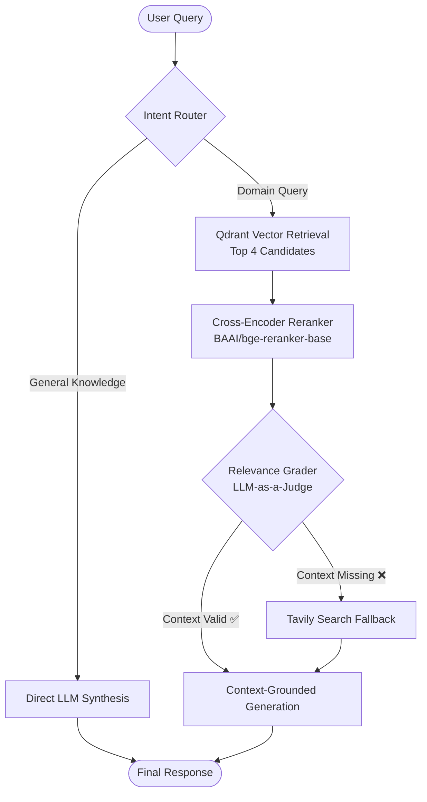

```markdown
# ⚡ Adaptive Agentic RAG: Autonomous Self-Corrective Retrieval Engine

[](https://www.python.org/)
[](https://github.com/langchain-ai/langgraph)
[](https://groq.com/)
[](https://qdrant.tech/)
[](https://opensource.org/licenses/MIT)

An industrial-grade, multi-stage **Agentic Retrieval-Augmented Generation (RAG)** pipeline. Unlike standard Naïve RAG systems that perform linear document lookup, this engine features a cyclic state machine built on **LangGraph** that performs **autonomous query routing, two-stage neural reranking, document relevance grading, and dynamic fallback web retrieval** to eliminate hallucinations.

---

## 🏗️ Architecture & State Graph



---

## 🌟 Key Engineering Highlights

* **Dynamic Intent Routing:** Automatically classifies user intent using structured JSON schemas, bypassing the vector database for general conversational queries to reduce latency and token usage.
* **Two-Stage Retrieval (Bi-Encoder + Cross-Encoder):** Combines fast vector similarity search using `BAAI/bge-small-en-v1.5` with deep semantic reranking using `BAAI/bge-reranker-base` to isolate high-precision chunks.
* **Self-Corrective Fallback Loop (CRAG):** Employs an LLM document grader that scores retrieved context. If local context is missing or irrelevant, the agent triggers **Tavily Web Search** dynamically.
* **Automated Quantitative Benchmark:** Integrated evaluation engine that uses LLM-as-a-judge to score **Faithfulness** and **Answer Relevance** across diverse test sets.
* **Interactive Trace UI:** Built with **Streamlit**, exposing real-time execution steps, cross-encoder scores, and retrieved document payloads.

---

## 📊 Evaluation & Benchmark Results

The pipeline was benchmarked using an automated evaluation pipeline to verify response quality and guard against hallucination:

| Query Type | Evaluated Question | Faithfulness (0-1) | Answer Relevance (0-1) |
| --- | --- | --- | --- |
| **Vector DB Hit** | *How do LPUs compare to GPUs for batch size 1 inference workloads?* | **1.00** | 0.85 |
| **Vector DB Hit** | *How does the Groq compiler optimize model execution on SRAM?* | **1.00** | 0.88 |
| **Direct Chat Bypass** | *What is the capital of Japan?* | **1.00** | 1.00 |
| **Fallback Web Search** | *Who won the ICC T20 World Cup in 2024?* | **1.00** | 1.00 |

### Summary Metrics

* **Mean Faithfulness:** `1.00 / 1.00` (Zero context hallucination)
* **Mean Answer Relevance:** `0.93 / 1.00`

---

## 🛠️ Tech Stack

* **Orchestration:** LangGraph, LangChain Core
* **LLM Engine:** Groq API (`qwen/qwen3.6-27b` / `openai/gpt-oss-120b`)
* **Vector Store:** Qdrant Cloud Cluster
* **Embeddings & Reranking:** Hugging Face `sentence-transformers` (`bge-small-en-v1.5`, `bge-reranker-base`)
* **Live Search API:** Tavily
* **Frontend:** Streamlit

---

## 🚀 Quickstart Guide

### 1. Clone the Repository

```bash
git clone [https://github.com/](https://github.com/)<your-username>/agentic-rag-engine.git
cd agentic-rag-engine

```

### 2. Set Up Virtual Environment

```bash
python -m venv .venv
# On Windows:
.venv\Scripts\activate
# On Linux/macOS:
source .venv/bin/activate

```

### 3. Install Dependencies

```bash
pip install -r requirements.txt

```

### 4. Configure Environment Variables

Create a `.env` file in the root directory:

```env
GROQ_API_KEY="your_groq_api_key"
QDRANT_URL="[https://your-cluster.cloud.qdrant.io:6333](https://your-cluster.cloud.qdrant.io:6333)"
QDRANT_API_KEY="your_qdrant_api_key"
TAVILY_API_KEY="your_tavily_api_key"

```

### 5. Ingest Sample Knowledge Base

```bash
python setup_rerank_data.py

```

### 6. Run the Application

**Terminal Execution:**

```bash
python full_agent.py

```

**Launch Streamlit UI:**

```bash
streamlit run app_ui.py

```

**Run Quantitative Benchmark:**

```bash
python evaluate_rag.py

```

---

## 📂 Project Structure

```text
├── full_agent.py          # Core LangGraph state machine & agent nodes
├── evaluate_rag.py        # Automated LLM-as-a-judge evaluation suite
├── setup_rerank_data.py   # Vector ingestion script with cross-encoder data
├── app_ui.py              # Interactive Streamlit chat interface
├── requirements.txt       # Project dependencies
├── .env.example           # Environment template
└── README.md              # Project documentation

```

---

## 📜 License

This project is licensed under the MIT License - see the [LICENSE](https://www.google.com/search?q=LICENSE) file for details.

```

```
